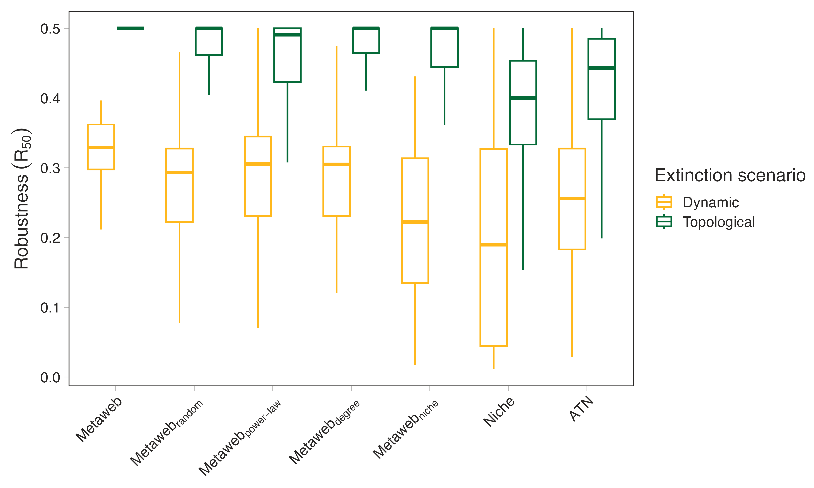

# Introduction

Understanding how species loss propagates through ecological communities is a central challenge in ecology. The extinction of a species can have consequences that extend beyond the direct loss of that species, as the removal of ecological interactions can cause further species to decline or disappear. These secondary extinctions can generate cascading losses of biodiversity, alter community composition and disrupt ecosystem functioning. Predicting the consequences of species loss therefore requires understanding not only which species are initially threatened, but also how their removal affects the persistence of other species within the community. Food web models provide a framework for investigating these processes by representing feeding relationships among species and simulating the consequences of species removal. In this context, extinction robustness describes the capacity of a community to withstand species loss before substantial secondary extinctions occur [@curtsdotterRobustnessSecondaryExtinctions2011].

Secondary extinction simulations generally involve two components: a primary extinction sequence, which determines the order in which species are initially removed, and secondary extinctions, which determines when the loss of a species or its interactions causes other species to become extinct. Primary extinction sequences can represent different ecological or environmental pressures, for example, the removal of species according to their abundance, traits or randomly. Secondary extinction rules then determine how the remaining community responds. In topological approaches, these rules are based on network structure where species are considered extinct when they lose the trophic connections required to persist, typically all of their resources. These approaches provide a tractable way to investigate how network structure influences extinction cascades, but they do not explicitly represent the population or indirect processes governing species persistence. In particular, they cannot account for changes in population biomass, rates of resource consumption, indirect interactions such as apparent or emerging competition, or the potential for species to persist despite changes in their interactions.

Dynamic food web models provide an alternative by explicitly representing population and energetic processes. Rather than inferring secondary extinctions from the loss of network connections alone, these models simulate changes in species biomass through time, allowing extinctions to emerge when populations decline below persistence thresholds [@yodzisBodySizeConsumerResource1992; @broseConsumerResourceBodySize2006; @delmasSimulationsBiomassDynamics2017]. Consequently, dynamic models can capture processes that are absent from purely topological simulations, including the effects of changing resource availability and the rates at which consumers and resources interact. Previous comparisons have shown that topological and dynamic approaches can produce substantially different estimates of extinction robustness, with topological simulations often suggesting greater robustness than dynamic simulations [@curtsdotterRobustnessSecondaryExtinctions2011]. Dynamic approaches are therefore important when the aim is to understand the population-level mechanisms underlying extinction cascades, rather than simply the structural consequences of species removal.

Despite these advantages, secondary extinction research has relied predominantly on topological approaches [REF]. Furthermore, where dynamic models have been used to investigate general principles of food web robustness, network structure has commonly been generated using theoretical approaches such as the niche model [@Williams2000Simple]. The niche model generates plausible food web structures by arranging species along a continuous niche axis and assigning consumers a feeding range within that axis. It reproduces several characteristic properties of empirical food webs providing a convenient means of generating networks for subsequent dynamic simulations. However, it is species-agnostic, whereby interactions are generated from generalised structural rules rather than from knowledge of the ecological relationships between particular species. Consequently, although niche-model networks can provide useful conceptual insight into how general properties of food web structure influence extinction dynamics, they do not necessarily represent the interactions occurring within any particular ecological community.

Allometric trophic network models offer a step towards greater biological realism by incorporating consumer–resource body-size relationships and associated assumptions about feeding interactions [@broseConsumerResourceBodySize2006; @petcheyTrophicallyUniqueSpecies2008]. However, body size is only one component of trophic feasibility. Species also differ in their feeding strategies, habitat requirements, functional morphology and other ecological characteristics that constrain which interactions are possible [REF]. Networks generated primarily from body-size relationships may therefore include interactions that are theoretically plausible under allometric assumptions but biologically impossible for the particular species involved. In other words, incorporating population dynamics and additional biological constraints does not necessarily mean that a model preserves the identity of ecologically possible interactions within a real community. This distinction matters because extinction pathways depend not simply on the number or distribution of links, but on which species interact and which alternative resources are available to particular consumers.

The application of dynamic extinction models to networks retaining species-specific interaction identity remains limited, particularly in contemporary food web research [REF: review of species-specific dynamic food web applications]. This represents an important obstacle to moving from general conceptual predictions towards system-specific inference. If the objective is to predict how the loss of a particular species will affect the composition and functioning of a particular ecological community, then the model must represent the interactions that are possible between the species in that system. A dynamically realistic model supplied with a network that does not represent those relationships may produce mechanistically detailed predictions, but those predictions need not describe the ecological system of interest. The challenge is therefore to combine the population-level processes represented by dynamic models with food web structures that retain empirically grounded, species-specific interaction identity.

Empirical grounded metawebs offer an opportunity to address this challenge. By compiling potential trophic interactions among particular species from observations, published literature and trait-based inference, metawebs retain information about the identity of consumer–resource relationships that is absent from species-agnostic network generation approaches [@dunneNetworkStructureFood2006a]. This is important for extinction modelling because the loss of a species removes a particular set of ecological relationships, potentially affecting consumers in ways that depend on the identity and availability of their alternative resources. However, metawebs represent pools of potential interactions rather than necessarily realised community networks. Interactions may have been recorded or inferred across different locations, environmental conditions and periods, and therefore need not all occur simultaneously within a single ecological community [@strydomScalingMetawebsRealised2026]. As a result, metawebs can be highly connected relative to realised food webs and may include interactions that are possible in principle but not realised under the ecological conditions of a particular system. Directly using an entire metaweb as the input to a population dynamic model therefore risks representing a community that does not correspond to a plausible realised ecological system.

Translating empirical metawebs into networks suitable for dynamic modelling requires a means of distinguishing the pool of potential interactions from those likely to be realised within a particular community. Downsampling provides a promising approach by reducing the number of interactions while retaining the identity of the species involved [EG ROOPNARINE]. Rather than generating links from generalised structural rules, downsampling begins with an empirically constrained pool of potential interactions and selects a subset to represent a plausible community-level food web. This offers a way to retain species-specific trophic relationships while reducing the excessive connectivity of metawebs and avoiding the introduction of links between species for which no potential interaction is represented in the empirical interaction pool. In this way, downsampling provides a potential bridge between empirical interaction data and mechanistic dynamic modelling.

However, the selection of interactions to remove or retain is not necessarily neutral. Different downsampling approaches embody different assumptions about how potential interactions are filtered into realised communities. These assumptions may preserve different subsets of species interactions, with consequences for network structure, the resources available to individual consumers and the secondary extinction pathways supported by the resulting network. In particular, alternative approaches may produce different predictions about the identity of species lost, even when they begin with the same empirical metaweb. Thus, incorporating species-specific interaction identity into dynamic models does not remove uncertainty from network construction; rather, it makes it possible to investigate how assumptions about the realisation of potential interactions influence subsequent ecological predictions.

> Network construction is also not the only process determining which interactions ultimately contribute to community persistence. Once a network has been parameterised and subjected to population dynamics, an initial burn-in period allows biomass to change and species unable to persist under the specified model conditions to become extinct. This imposes a further filter on the network, transforming the initially constructed topology into a dynamically viable community. Interactions retained during downsampling may therefore not necessarily persist in the resulting community if their associated species fail to maintain viable populations. Conversely, the removal of particular species during burn-in can alter the structure of the surviving network. The resulting community reflects both the assumptions used to select interactions from the original metaweb and the constraints imposed by population dynamics. Understanding how these successive filters influence network structure is important for determining whether empirical interaction identity is retained through dynamic modelling, and whether alternative approaches to network construction ultimately produce different ecological outcomes.

> probably need a version of the paragraph below...

These challenges are particularly relevant when modelling ecological communities for which complete observations of realised food webs are unavailable, including palaeoecological systems. Fossil assemblages provide opportunities to investigate ecological change across major extinction events, but interactions reconstructed from the fossil record are more appropriately understood as empirically constrained pools of potential trophic relationships than as complete representations of a single realised community [@roopnarineEcologicalModellingPaleocommunity2017; @roopnarineExtinctionCascadesCatastrophe2006; @frickeCollapseTerrestrialMammal2022; @dunhillExtinctionCascadesCommunity2024; @karapunarNoGlobalCollapse2026]. Developing approaches that translate these interaction pools into plausible, dynamically viable food webs could provide a means of moving beyond structural reconstructions towards mechanistic explanations of ecological change, including the processes underlying extinction cascades and community collapse. More broadly, the ability to combine species-specific interaction information with population dynamics is essential if food web models are to move towards system-specific predictions that can inform our understanding of ecological change and, ultimately, conservation and management in contemporary ecosystems [@strydomRoadmapPredictingSpecies2021].

Here, we investigate how empirically informed network reconstruction influences food web structure and inferred extinction robustness under topological and dynamic extinction simulations. Using empirical metawebs, we generate community-level networks through four alternative downsampling approaches and compare these with networks constructed using the niche and allometric trophic network models. By retaining species-specific interactions from empirical metawebs, our approach provides a means of incorporating interaction identity into dynamic extinction modelling while investigating the consequences of alternative assumptions about how potential interactions are realised. Specifically, we address four questions. First, how does downsampling approach influence network topology, and to what extent do these structural differences persist following dynamic burn-in? Second, does the difference between topological and dynamic estimates of extinction robustness generalise across alternative approaches to network construction and extinction scenarios? Third, do alternative network types retain similar relationships in inferred robustness under topological and dynamic extinction simulations, or does incorporating population dynamics reveal differences that are not apparent from topology alone? Fourth, how do alternative network construction approaches influence the retention and loss of individual species and trophic links during extinction simulations, and do topological and dynamic approaches differ in the identity of species and interactions that persist? 

Rather than identifying a single optimal reconstruction method, we investigate the extent to which empirical interaction identity can be retained through dynamic modelling, and how assumptions made during network construction propagate into subsequent ecological predictions. We show that downsampling approaches produce increasingly distinct network topologies as greater proportions of interactions are removed, that dynamic burn-in acts as an additional structural filter, and that the broad difference between topological and dynamic estimates of robustness is maintained across alternative network representations. However, dynamic simulations also reveal differences in network behaviour that are not apparent from topology alone. By examining species and link retention throughout extinction simulations, we further assess whether similar estimates of overall robustness conceal differences in the composition and interaction structure of surviving communities. Together, these findings demonstrate the potential of empirical metawebs and downsampling to bridge the gap between species-specific interaction data and mechanistic extinction modelling, while highlighting network reconstruction as an important source of uncertainty in ecological predictions.

# Methods

## Fossil data

We used community data from seven locations spanning the Permian-Triassic mass extinction (PTME) event compiled by @karapunarNoGlobalCollapse2026. This dataset comprises community-level trophic data representing potentially interacting taxa across seven locations across the Permian-Triassic mass extinction (PTME; \~250 Ma) event. Here we used the guild-level assemblages from the pre-extinction (Permian) time point along with the plankton and zooplankton data from the outputs of the EcoGEnIE models [@wardEcoGEnIE10Plankton2018] also used in @karapunarNoGlobalCollapse2026. These represent distinct communities of potentially interacting guilds. We excluded the community from Russia because it contained no intermediate species and was therefore unsuitable for the subsequent extinction analyses as it would produce distinct results. The seven locations act as replicates to better determine if observed extinction patterns are driven by specific network structures (location) or if results are more generalisable. Detailed descriptions of the underlying community data, including trait assignment, their composition and spatial structure, are provided in @karapunarNoGlobalCollapse2026.

## Network construction

Metawebs were constructed using the Paleo Food Web Inference Model (PFWIM; @shawFrameworkReconstructingAncient2024). The PFWIM applies a set of mechanistic feasibility rules to consumer–resource pairs based on different trait classes. An interaction is deemed as being feasible only when all trait combinations satisfy the specified rules. These metawebs were subsequently downsampled to the specified target connectance (see @sec-downsample for details on downsampling). Using the community data we also constructed networks using the allometric trophic network (ATN) model [@broseConsumerResourceBodySize2006], which represents a realised but empirically grounded network. For the ATN species body masses were sampled independently from a truncated log-normal distribution constrained by species categorical body-size classifications. Interaction probabilities were generated by varying the feeding threshold between 0.01 and 0.12 and selecting the network whose connectance most closely matched a target connectance. Finally for each community we also constructed a niche model network [@Williams2000Simple] using the guild richness and target connectance as input parameters (see @sec-simulations for details on parametrisation)

## Downsampling approaches {#sec-downsample}

We treat downsampling as an assumption on the process of ecological realisation rather than observation. Starting from a metaweb containing all potential trophic interactions, each downsampling approach represents an alternative ecological hypothesis describing how local ecological processes may filter these potential interactions into the subset that is realised within a particular community. The different approaches therefore differ not only in their implementation, but also in the ecological assumptions they embed about how realised food webs emerge from a common regional interaction pool.

### Niche

The original niche model from @Williams2000Simple assumes that realised interactions represent the core of a consumer's trophic niche, and that these diets can be arranged along a single niche axis. In order to create a downsampling approach that mimics this we infer a latent trophic axis directly from the metaweb using Singular Value Decomposition (SVD). It has been shown that the latent spaces described by the left and right singular vectors are closely aligned with the generality and vulnerability of species [@strydomFoodWebReconstruction2022a] and so the SVD composition should retain the dietary signal of the species. This is done as follows:

Let $A$ denote the $S \times S$ adjacency matrix of the metaweb, where $A_{ij}=1$ if consumer $i$ feeds on resource $j$. We compute its singular value decomposition,

$$
A = U \Sigma V^\top
$$

where $U$ and $V$ are the left and right singular vectors, respectively, and $\Sigma$ is the diagonal matrix of singular values. Using the leading singular value, $\sigma_1$, and corresponding singular vectors, $\mathbf{u}_1$ and $\mathbf{v}_1$, each species is assigned latent consumer and resource coordinates,

$$
c_i = \sqrt{\sigma_1}\,u_{i1}, \qquad r_i = \sqrt{\sigma_1}\,v_{i1}
$$

Because species can act both as consumers and as resources, these coordinates are combined to obtain a single niche position,

$$ 
x_i = \frac{c_i + r_i}{2}
$$

which is subsequently rescaled to lie between 0 and 1. Species with similar values of $x_i$ therefore occupy similar positions along the dominant trophic gradient of the metaweb.

For each consumer $i$, the centroid of its realised niche is

$$
\mu_i = \frac{1}{k_i}\sum_{j \in R_i} x_j
$$

where $R_i$ is the set of resources consumed by species $i$, and $k_i$ is its trophic breadth (generality). Niche breadth is estimated as the standard deviation of prey positions,

$$
\sigma_i = \max\left(sd(x_j),\,0.1\right)
$$

where the lower bound prevents unrealistically narrow niches for specialists. Niche breadth can optionally be scaled to further constrain realised diets,

$$
\sigma_i' = \alpha \sigma_i
$$

where $\alpha$ is acts as a scaling parameter.

The probability of retaining an interaction between consumer $i$ and resource $j$ is then

$$
P_{ij} \propto \exp\left[-\left(\frac{x_j-\mu_i}{\sigma_i'}\right)^2\right]
$$

Interactions closest to the consumer's niche centre are therefore most likely to be realised (retained), whereas interactions towards the margins of the niche are preferentially removed. Ecologically, this assumes that local communities realise the central portion of a consumer's potential trophic niche, with peripheral or opportunistic interactions occurring less consistently.

### Power-law

The power-law approach assumes that interaction realisation depends primarily on consumer trophic breadth. Following @roopnarineExtinctionCascadesCatastrophe2006, the retention probability for consumer $i$ is

$$
P_i \propto \exp\left(\frac{k_i}{E}\right)
$$

where $k_i$ is consumer generality and

$$
E = S^{(y-1)/y}
$$

with $S$ denoting network size and $y$ the scaling exponent. Probabilities are subsequently normalised to lie between 0 and 1. Every interaction belonging to consumer $i$ inherits the same retention probability,

$$
P_{ij}=P_i
$$

Ecologically, this represents the hypothesis that generalist consumers realise a larger fraction of their potential trophic niche than specialist consumers, irrespective of the identity of individual resources.

### Degree-product

The degree-product approach assumes that interaction realisation depends on the centrality of both interacting species. Here each interaction is assigned a weight

$$
w_{ij}=k_i^{out}k_j^{in}
$$

where $k_i^{out}$ is the consumer's out-degree (generality) and $k_j^{in}$ is the resource's in-degree (vulnerability). Retention probabilities are then calculated as

$$
P_{ij} = 1- \frac{w_{ij}}{\max(w)}
$$

before being constrained to the interval $[0,1]$. Under iterative downsampling, degrees are recalculated following each interaction removal, allowing probabilities to evolve as the realised network changes. Ecologically, this assumes that highly connected species possess many potential interactions that are not simultaneously realised within any local community, whereas interactions involving more specialised species are more likely to represent essential realised links.

### Random

Random downsampling provides the ecological null model. Every interaction has an equal probability of being retained,

$$
P_{ij}=c
$$

where $c$ is constant for all existing interactions. Interactions are removed uniformly at random until the target connectance is reached, subject to the constraint that species cannot become isolated. This assumes that no ecological process preferentially favours the realisation of one potential interaction over another, such that realised food webs constitute an unbiased subset of the regional metaweb that is ultimately only constrained by the number of links.

## Simulations {#sec-simulations}

For each empirical community, we generated 30 network replicates ($n$ = 30 replicates $\times$ 7 network types $\times$ 6 locations). For each replicate a target connectance was independently sampled from a truncated normal distribution bounded between 0.05 and 0.15. This target connectance was used to determine the 'degree of downsampling' of the metaweb for each downsampling approach as well as constraining the ATN and Niche networks. These represent the 'creation' networks

For the dynamic simulations body masses were assigned using the predator-prey body mass distribution where body mass ($M_i$) is assigned deterministically from the trophic level ($TL$) as follows $M_{i} = Z^{TL_{i}-1}$, where $Z$ represents the assumed constant predator–prey body-mass ratio, here set to 10. Note that even for the ATN networks we used this theoretical body size specification despite the network itself being constructed with empirical bodysizes. This is because we found that for networks which had empirically specified body sizes the community would almost completely collapse (see Supplementary Materials), which suggests the dynamic model itself is sensitive to this specification. Initial biomasses were drawn from a uniform distribution. These trait values were used to construct a series of alternative networks.

Each creation network was then parameterised using the default parameters [@delmasSimulationsBiomassDynamics2017] and ran the model until we had stable biomass fluctuation or up to 5000 time steps. Species whose biomass declined below the survival threshold ($10^{-12}$) during this burn-in period were considered extinct and removed from the network. The surviving species and their interactions constituted the corresponding 'realised' networks. 

For each 'creation' and 'realised' network we measured 32 network structural metrics (described in Table S1). These span a different components of network structure from macro-scale to node-level properties.

### Extinction simulations

For extinctions we followed the framework of @curtsdotterRobustnessSecondaryExtinctions2011 and simulated both topological and dynamic extinctions. Topological extinctions were done on both the 'creation' as well as 'realised' networks. For each type of extinction simulation we used the same ten extinction scenarios from @curtsdotterRobustnessSecondaryExtinctions2011 to determine the order of species to be removed for primary extinctions. For topological extinctions secondary extinctions occurred when species lost all prey, these secondary extinctions were allowed to cascade before the next primary extinction occurred. For dynamic extinctions primary extinctions were imposed by setting the biomass of the focal species to the survival threshold ($10^{-12}$), after which the community was simulated for a further 5000 time steps to allow for the downstream effects of the primary extinction to propagate through the system. Species whose biomass subsequently declined below the survival threshold were recorded as secondary extinctions and removed at the end of the 5000 time steps. This procedure was repeated until the entire community collapsed.

For each extinction scenario, robustness was quantified from the resulting extinction curves as the proportion of primary extinctions required to produce a 50% reduction in total species richness ($R_{50}$ [@jonssonReliabilityR50Measure2015]). In instances when a primary extinction would 'overshoot' the 50% robustness was estimated by linear interpolation between extinction events.

## Software

Network construction and extinction simulations were run in Julia v1.12.6 [@bezansonJuliaFreshApproach2017], we used `EcologicalNetworksDynamics.jl` [@lajaaitiEcologicalNetworksDynamicsjlJuliaPackage2025] for dynamic simulations, `PFIM.jl` [REF] for construction of metawebs, `FoodWebTools.jl` [REF] for network downsampling, and `Extinctions.jl` [REF] for extinctions and robustness calculations. Statistical analyses were run in R v4.5.2 [@RCoreTeam2024]. All code can be found at *TODO*

# Downsampling and burn-in alter network topology in method-dependent ways

Redundancy analysis (RDA), using permutation-based significance testing while accounting for community-level variation, revealed that downsampling approach significantly affected network topology, but that this effect depended on the magnitude of connectance reduction required to reach the target connectance (999 permutations; $F_{7, 707}$ = 112.8, $p$ = 0.001; @fig-downsample, panel A). The type of network (*i.e.,* downsampling approach) explained 31.8% of total topology variation (adjusted $R^2$ = 0.318), with community identity accounting for an additional 39.7% of variation. The significant interaction between downsampling approach and connectance change (marginal test; $F_{3, 707}$ = 18.90, $p$ = 0.001) demonstrated that topology trajectories differed among downsampling methods depending on the degree of downsampling required. Thus, the extent to which network structure diverged from the original topology depended on both the severity of downsampling and the mechanism by which interactions were removed.

![**Downsampling approach influences both network topology and subsequent structural reorganisation during burn-in.** (A) Redundancy analysis (RDA) ordination showing differences in network topology among downsampling approaches across the downsamping ($\Delta Co$) gradient after accounting for community-level variation. (B) Principal component trajectories illustrating structural change between network creation and burn-in for each downsampling approach. (C) Loadings of the top ten contributing structure metrics.](figures/downsamplingEffect.png){#fig-downsample}

We next asked whether these structurally distinct networks responded differently during the burn-in phase (@fig-downsample, panel B). Structural reorganisation was quantified as the Euclidean displacement between network positions before and after burn-in in the first three principal component dimensions, with location included as a random effect to account for the substantial variation among location. Burn-in displacement differed significantly among network types ($F$ = 62.0, $p$ < 0.001). Metawebs underwent the greatest structural reorganisation, whereas ATN networks exhibited the smallest displacement. Among the downsampled networks, all but the randomly downsampled networks had a displacement similar to that of the Niche model (Figure S2), while all downsampled networks showed displacement distinct from the original metaweb. When looking at the loadings of the first two PC axes (@fig-downsample, panel C), the primary changes in structure were related to node-level measures and, unsurprisingly, the number of links. This is to be expected since there is no rewiring of links permitted in this system, and as such any changes should be driven by the loss of nodes rather than a major reorganisation of network structure.

Together, these analyses demonstrate that downsampling approach influences network topology both during the initial downsampling step and during the subsequent burn-in phase. Differences among downsampling methods become increasingly pronounced as greater proportions of interactions are removed, consistent with the expectation that the ecological assumptions underlying each removal strategy would become more embedded as more links are removed. Importantly, despite generating distinct initial topologies, the different downsampling approaches underwent remarkably similar structural reorganisation during burn-in, changing in ways more similar to the niche model than the original metaweb. This suggests that ecologically informed downsampling of metawebs allows us to produce networks whose subsequent structure more closely resembles that of realised networks, while also suggesting that the burn-in phase is, in and of itself, an additional network realisation step. Notably, the two realised models (Niche and ATN) do not behave similarly and still end up at different 'end points' following burn-in compared with the empirical webs, highlighting that the choice of network reconstruction approach will still have a strong effect on the structure and behaviour of the system [@strydomAreWeMapping2026].

# Differences in inferred robustness of topological and dynamic extinctions are unaffected by network type

To determine whether the qualitative differences between topological and dynamic extinction simulations previously demonstrated by @curtsdotterRobustnessSecondaryExtinctions2011 generalise across alternative network reconstructions, we compared the difference in robustness ($\Delta R_{50}$) among network types for each extinction scenario while accounting for community-level variation. Network type significantly affected $\Delta R_{50}$ across extinction scenarios (model summaries in Table S2), indicating that the magnitude of the difference between topological and dynamic robustness depended on network reconstruction.

Despite these quantitative differences, the qualitative pattern identified by @curtsdotterRobustnessSecondaryExtinctions2011 was largely maintained. Under all but random basal removal, topological extinction inferred greater robustness than dynamic extinction for every network type, although the magnitude of this discrepancy varied among reconstruction methods (@fig-TopoVDynamic). Random basal extinction represented the only notable departure from this general pattern (Figure S3). Here, the discrepancy between topological and dynamic robustness was substantially reduced, with power-law and degree-product downsampled networks exhibiting a slightly higher $\Delta R_{50}$ and random downsampled networks showing little difference between the two approaches. Thus, the conclusion that topological analyses provide more conservative estimates of robustness, although not universal, remains remarkably robust across reconstruction methods and extinction scenarios.

{#fig-TopoVDynamic}

Together, these analyses demonstrate that the principal conclusion of @curtsdotterRobustnessSecondaryExtinctions2011 extends well beyond the niche model. While the precise magnitude of the discrepancy between topological and dynamic robustness depends on both network reconstruction and extinction mechanism, the qualitative tendency for topological extinction simulations to infer greater robustness than dynamic simulations were recovered across most reconstructed food webs examined here.

# Dynamic extinctions re-enforce ecological assumptions

For each community $\times$ extinction scenario $\times$ time point, $R_{50}$ was modelled as a function of network type, and estimated marginal means were compared using Tukey-adjusted pairwise contrasts (Figure S4-6). Network-type pairs with adjusted $p \geq$ 0.05 were considered indistinguishable, and the frequency of indistinguishable comparisons was summarised across scenarios (Figure S7). To identify broader groupings of network types, estimated marginal means were standardised, Euclidean distances among network types were calculated, and hierarchical clustering was performed using Ward's $D^2$ method (@fig-robDynamic).

![**Clustering of network types based on similarity in inferred robustness ($R_{50}$).** Dendrograms show hierarchical clustering of network types based on their estimated marginal mean ($R_{50}$) values across community (\times) extinction scenario combinations. Clustering was performed separately for each extinction time point after standardising estimated marginal means across network types, using Euclidean distances and Ward's ($D^2$) method. Branch colours indicate three clusters of network types](figures/robustnessClusters.png){#fig-robDynamic}

In terms of topological robustness, metaweb derived networks consistently formed a distinct cluster separate from the two realised networks (niche model and ATN; @fig-robDynamic, top two rows). However, under dynamic extinction simulations, this grouping broke down, with a reshuffling of the relative similarity among network types (@fig-robDynamic, bottom row). Most notably, the niche downsampled networks converged with those of the Niche model, whereas the remaining empirically derived networks maintained their mutual similarity.

Topological extinction simulations primarily interrogate network architecture and therefore retain the common structural signature inherited from the metaweb. Dynamic simulations introduce biomass- and rate-dependent interactions, revealing differences among networks that are not apparent from topology alone. When examining topological extinctions, it is clear why empirically derived networks behave similarly to one another: they share a common baseline architecture inherited from the regional metaweb (@fig-downsample, panel B), and topological cascades depend strictly on network topology. For dynamic extinctions, however, network behaviour is not determined solely by initial structure. Instead, higher-order differences emerge from how model parameterisation interacts with network topology. Thus, network structure appears sufficient to explain much of the similarity in responses to topological extinctions, but is insufficient to predict responses to dynamic extinctions, where functional parameterisation introduces additional sources of variation. Although the clustering pattern was not universal across communities (Figures S8-10), suggesting that initial network structure still exerts an influence.

This raises an important question about the role of network connectance -- to what extent does specifying connectance constrain the structural and dynamical properties of generated networks? Work from @poisotWhenEcologicalNetwork2014 and @strydomSVDEntropyReveals2021 shows that less-connected networks can exhibit greater structural complexity, because there are many ways to arrange a small number of links but progressively fewer ways to arrange links as a network becomes fully connected. At low connectance, we therefore expect a much larger number of possible network configurations, meaning that in specifying connectance we place constraints on the precise structure of the resulting network. This provides one possible explanation for why increasingly aggressive downsampling can amplify differences among reconstruction approaches: as fewer interactions are retained, the ecological assumptions used to determine which interactions remain have greater scope to shape the resulting network.

# Conclusions

Reconstructing realised food webs from regional interaction pools requires assumptions about which potential interactions are likely to occur together. Here, we demonstrate that alternative downsampling approaches can produce dynamically viable food webs from the same empirical metaweb, but that the resulting networks retain detectable signatures of the assumptions underlying their construction. These differences become increasingly pronounced as greater proportions of interactions are removed, indicating that downsampling is not a neutral step between empirical data collection and dynamical modelling.

Our results further suggest that dynamical burn-in represents a second form of network realisation. Although burn-in altered the structure of all networks, it did not erase the differences introduced during initial network construction. Instead, the dynamical model acted as an additional filter, determining which structurally feasible networks could persist under its assumptions about biomass, interaction strengths, and species persistence. The ecological behaviour of a simulated community is therefore shaped by successive filters. First, how potential interactions are realised within a network, and second, how that network is filtered into a dynamically viable community.

Despite these differences in network structure and dynamical behaviour, the broad relationship between topological and dynamic robustness was consistent across network reconstruction approaches. Topological extinction simulations generally indicated greater robustness than dynamic simulations, consistent with previous work [@curtsdotterRobustnessSecondaryExtinctions2011]. This suggests that some conclusions drawn from network topology may be relatively robust to uncertainty in network reconstruction [@strydomAreWeMapping2026]. However, dynamic simulations also revealed differences among networks that were not apparent from topology alone, demonstrating that networks generated from the same empirical interaction pool can exhibit different dynamical behaviour depending on the assumptions used to realise that pool.

These findings highlight an important challenge for the growing use of dynamic food web models to move beyond describing network structure towards predicting ecological change. Increasingly sophisticated approaches can reconstruct networks from empirical observations or biological traits, while regional metawebs provide a means of retaining broad empirical information about potential interactions. Yet neither empirical provenance nor mechanistic parameterisation necessarily produces a realised community as both require assumptions about which interactions occur together and (in dynamic models) which of those interactions can persist. Network realisation therefore represents a necessary but currently underappreciated bridge between empirical interaction data and mechanistic dynamic modelling.

Developing a clear framework for explicitly incorporating empirical metawebs into dynamic models is an important step towards bridging theoretical work on network stability with real-world communities and ecological scenarios. Our case study reinforces the findings of @curtsdotterRobustnessSecondaryExtinctions2011, suggesting that topological extinction simulations alone may underestimate the importance of top-down effects in determining secondary extinctions and community robustness. Intentional downsampling provides a means of approximating the structure of realised communities [@roopnarineExtinctionCascadesCatastrophe2006], helping to integrate ecological realism with theoretical predictions. If palaeoecological communities can be reconstructed as plausible, dynamically viable food webs, dynamic modelling could provide a route to testing mechanistic explanations of observed ecological change rather than relying solely on topological reconstructions. Our results represent a first step towards this goal, while demonstrating that the assumptions underlying network construction can remain detectable throughout the modelling process.

Rather than identifying a single correct method for constructing realised networks, we argue that network realisation should be recognised as a methodological choice that can influence model outcomes. We therefore recommend that researchers who use downsampling explicitly test the sensitivity of their results to alternative downsampling approaches. As food web modelling increasingly combines empirical interaction data with dynamic approaches, predictions will depend not only on the equations governing population dynamics, but also on how empirical knowledge is translated into the networks on which those equations operate. Understanding and quantifying this additional source of uncertainty will be essential if dynamic food web models are to provide increasingly empirically grounded predictions of how ecological communities respond to environmental change.

# References {.unnumbered}

::: {#refs}
:::
